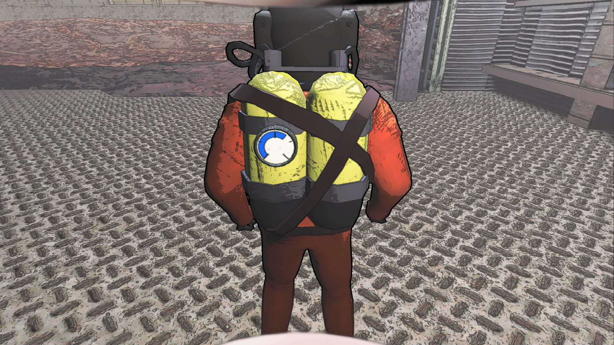
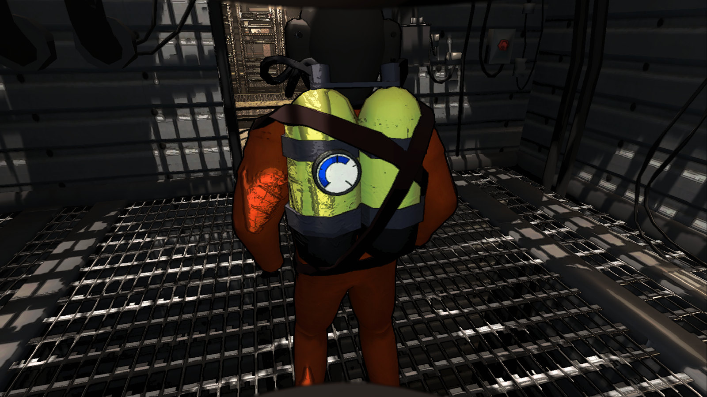
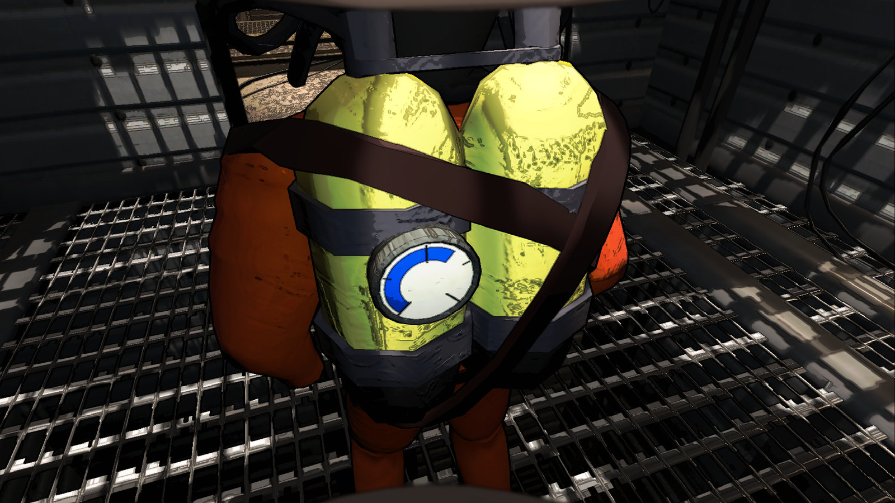
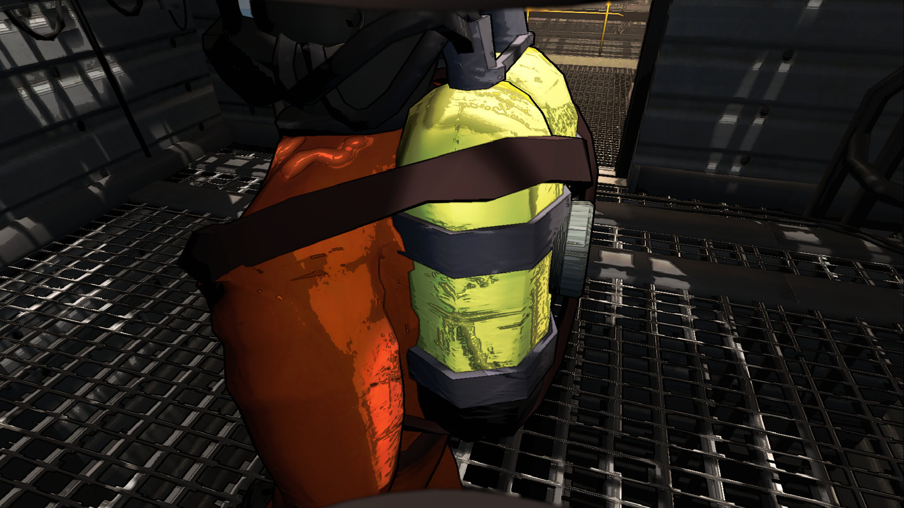
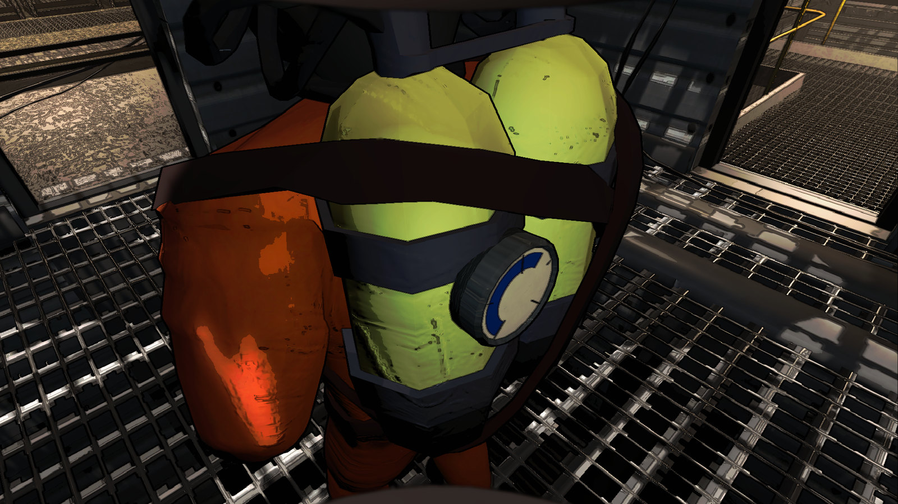
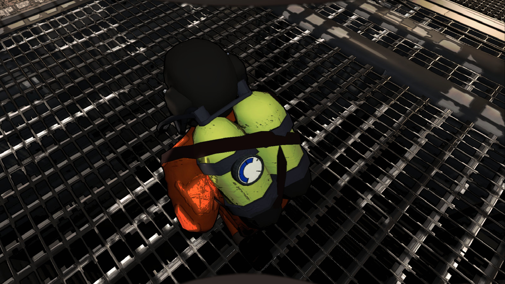
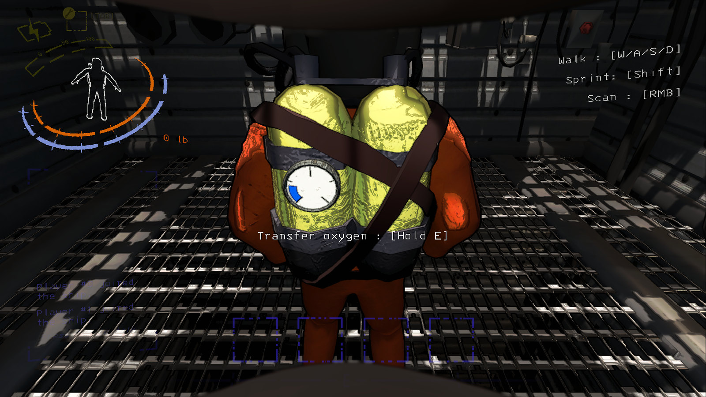
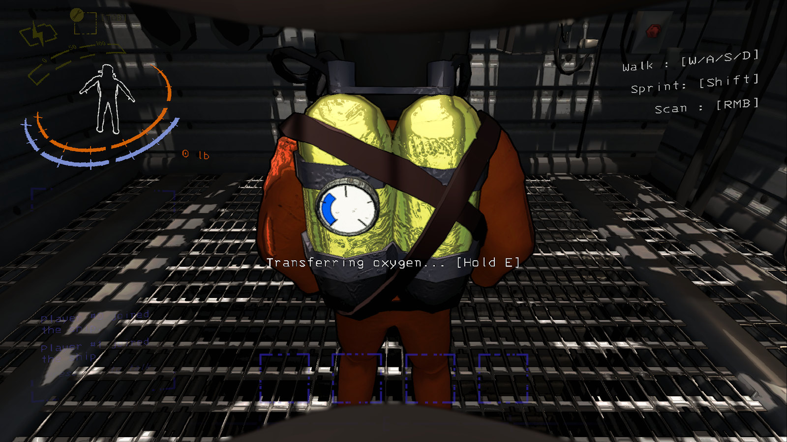
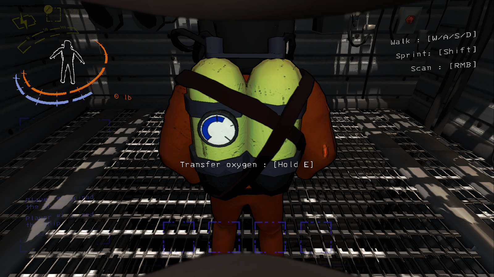
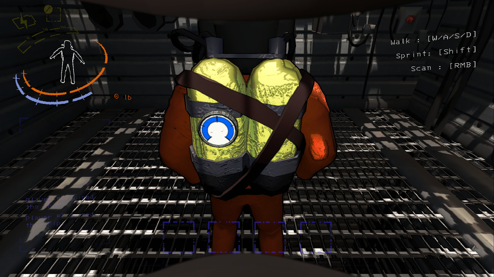

# Oxygen sharing — in-game screenshots

Web-optimized JPEG previews of screenshots captured in Lethal Company v81 on
Experimentation and inside its generated facility. The source captures are
1920 × 1080; previews are resized to 1600 pixels wide and compressed for faster
loading. The original PNGs remain in Git history.

## Backpack gauge

The gauge stays visible with the HUD hidden. Its blue arc fills from left to right;
elongated marks span the blue band at 0%, 50% and 100%, with shorter edge marks
at 25% and 75%.

The rough, worn case receives scene lighting. Its fitting, saddle and curved
clamp seat against the tank. The dial sits clear of the stock harness and follows
the upper spine's animated position and orientation, including crouching.

## How to share oxygen

**1. Approach from behind and aim at the backpack.** The Interact prompt appears
when the teammate is in range and the path is clear.

**2. Hold Interact.** The prompt changes to “Transferring oxygen…”, the teammate's
blue arc grows and your own HUD oxygen arc decreases.

**3. Release to stop.** The teammate keeps the received oxygen. In this sequence,
the recipient starts at 20% and finishes at about 60% after eight seconds at the
default rate of 5% of a tank per second.

**A full tank stops the transfer automatically.** The blue arc reaches its last
mark and the transfer prompt disappears.

Interact is E by default. These captures use an English US keyboard layout, so
the native prompt displays **E**. It shows a single keyboard binding, without
the gamepad alternative.

## Capture details

- Captured on 2026-10-24, host plus one remote LAN client, vanilla orange suits.
- Production Oxygen.dll SHA-256:
  `1FAB4CF001BB631893D1223E45A88A756CE33BF885152B85AD239B4B9052F15E`.
- The excluded LiveProbe helper stages player positions and starting tank amounts,
  lands the ship, uses the real facility entrance, and sends native Interact input.
- The gameplay render texture and screenshots use 1920 × 1080. Daylight is fixed
  for the outdoor shot; a local point fill light supplements the scene lighting.
  These are staged demonstration captures, not a manual walking playtest.
- Gameplay UI, gauge, blue fill and level marks are rendered by the game. There
  is no image retouching, fabricated UI or composited gauge in the original source captures.
- Snapshots in `capture-evidence.json` were sampled near the captures; they are
  not guaranteed to match the screenshot's exact frame. The recipient gains
  about 40% of a tank, matching the donor's loss within floating-point precision.
- Test profiles, logs and original screenshots remain in workspace directory
  `.multiplayer-test/gauge-mount-animated-20261024/`. Both games were closed and
  the three original save files restored with SHA-256 verification.

The screenshots are prepared locally for GitHub; this does not publish a release
or push repository changes. These captures validate the current visual changes
and the demonstrated transfer; they do not rerun all earlier compatibility tests.

The source filename for the preview `10-gauge-crouched.jpg` is `diagnostic-crouch.png` in
the source run and its capture evidence.
